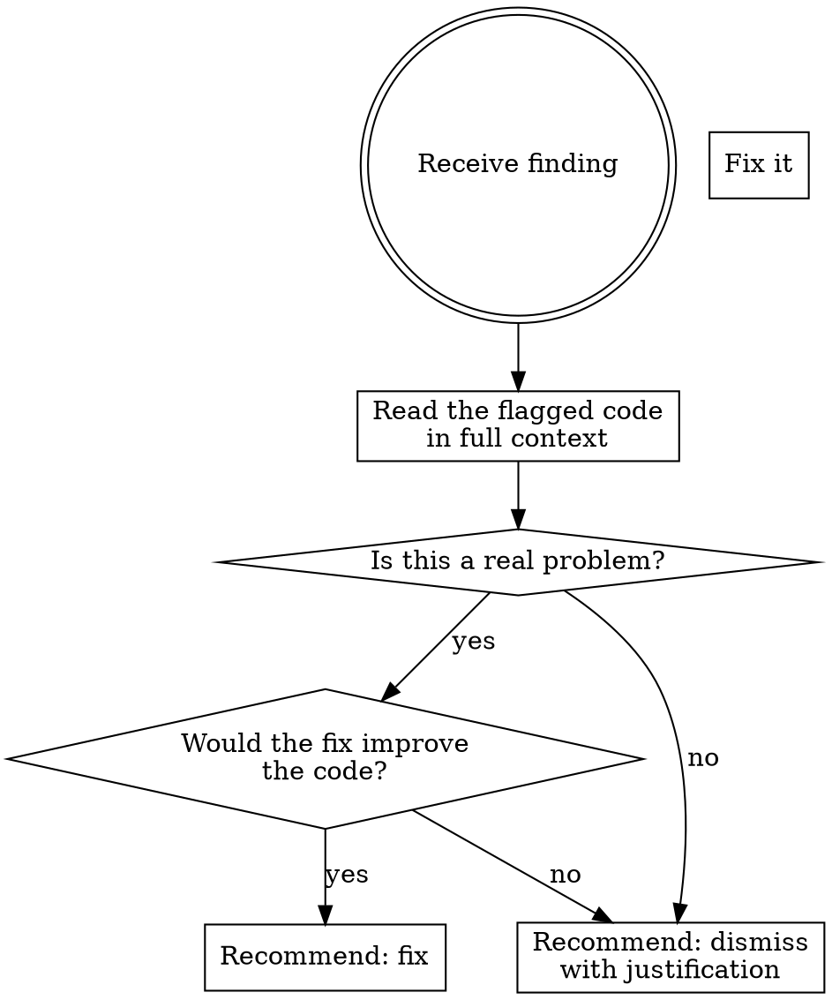

# SonarQube Finding Triage

## Overview

Evaluate every SonarQube finding critically before making changes. Not every finding warrants a code change — some are false positives, low-value noise, or would make the code worse if "fixed." Your job is to be a technical filter, not a compliance bot.

## Core Rule

**Never fix a SonarQube finding without first stating whether you agree with it and why.**

## Triage Flow

## Before Touching Code

For every finding, answer these questions:

1. **What is SonarQube actually complaining about?** (rule ID, severity, category)
2. **Read the flagged code and its surroundings.** Understand the full context — callers, base classes, subclasses, how it's used.
3. **Do you agree this is a real issue?** Consider:
   - Is this a false positive? (e.g., SonarQube doesn't understand the framework pattern)
   - Is the severity appropriate? (e.g., a "blocker" that has zero real-world impact)
   - Does the rule even apply to this codebase's context?
4. **Would the fix make the code better or worse?**
   - Does it add unnecessary complexity?
   - Does it break the existing pattern for no real gain?
   - Is it purely cosmetic with no functional benefit?

## Response Format

Always respond with a verdict before proposing changes:

**If you agree:**
> **Agree — [rule ID]**: [1-sentence explanation of why this is a real issue]. Here's the fix: ...

**If you disagree:**
> **Disagree — [rule ID]**: [Explanation of why this isn't a real issue in this context]. Recommend marking as "won't fix" because: ...

**If it's borderline:**
> **Borderline — [rule ID]**: [Trade-off explanation]. Fixing would [benefit] but also [cost]. Your call — want me to fix it or dismiss it?

## Common Dismiss Reasons

| Pattern | Example | Why Dismiss |
|---------|---------|-------------|
| Base class contract | `async def` without `await` in ABC default | Subclasses are async; removing `async` breaks the interface contract |
| Framework convention | Unused parameter in handler | Framework requires the signature |
| Dead code by design | Feature flag paths | Intentionally present for future use |
| Duplicate string in ORM | Repeated table names in ForeignKey | Constants add indirection without improving safety |
| Test-only code | Less rigorous patterns in tests | Test readability > production rigor |

## What to Always Fix

- **Security blockers**: Hardcoded secrets, injection vulnerabilities, exposed credentials
- **Bugs**: Actual logic errors, race conditions, null dereferences
- **Deprecated APIs**: Using APIs that will break in future versions

## What to Scrutinize

- **Code smells**: Often subjective — evaluate case by case
- **Maintainability**: "Define a constant" for 3 occurrences might not be worth it
- **Convention rules**: May conflict with the project's established patterns
- **Complexity metrics**: Sometimes complex code is the clearest way to express complex logic

## Red Flags — You're Being a Compliance Bot

- Adding `asyncio.sleep(0)` just to satisfy an async lint rule
- Creating constants that are only meaningful as inline values (e.g., `HTTP_STATUS_400 = 400`)
- Restructuring working code to satisfy a metric with no real-world benefit
- Adding workarounds that make code harder to read

If you catch yourself doing any of these, stop and recommend dismissing the finding instead.
